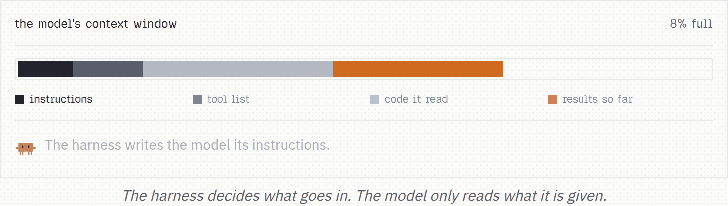
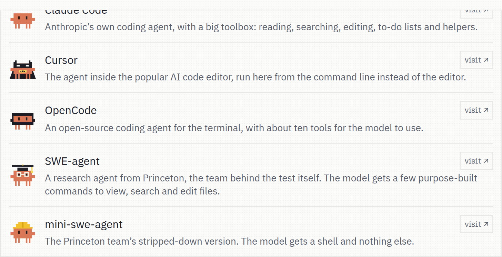
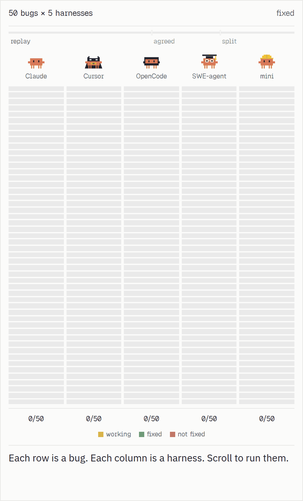
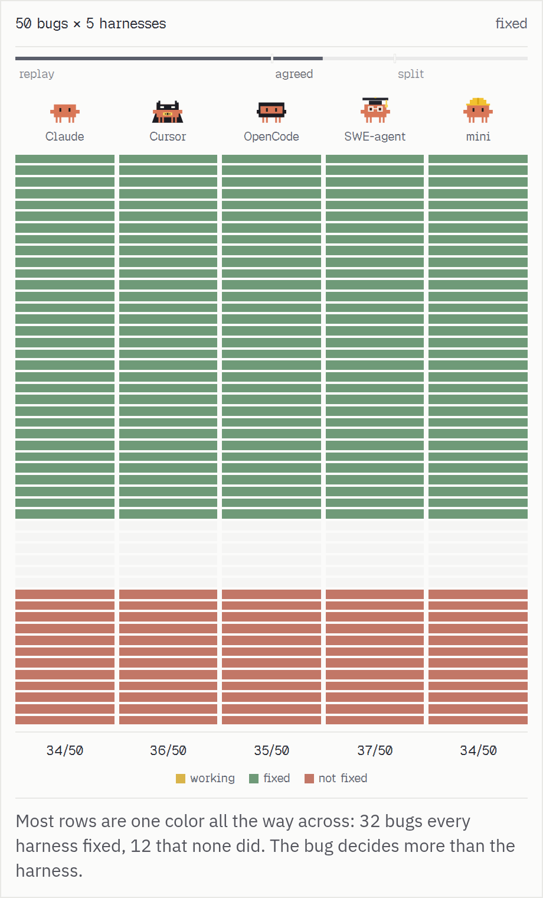
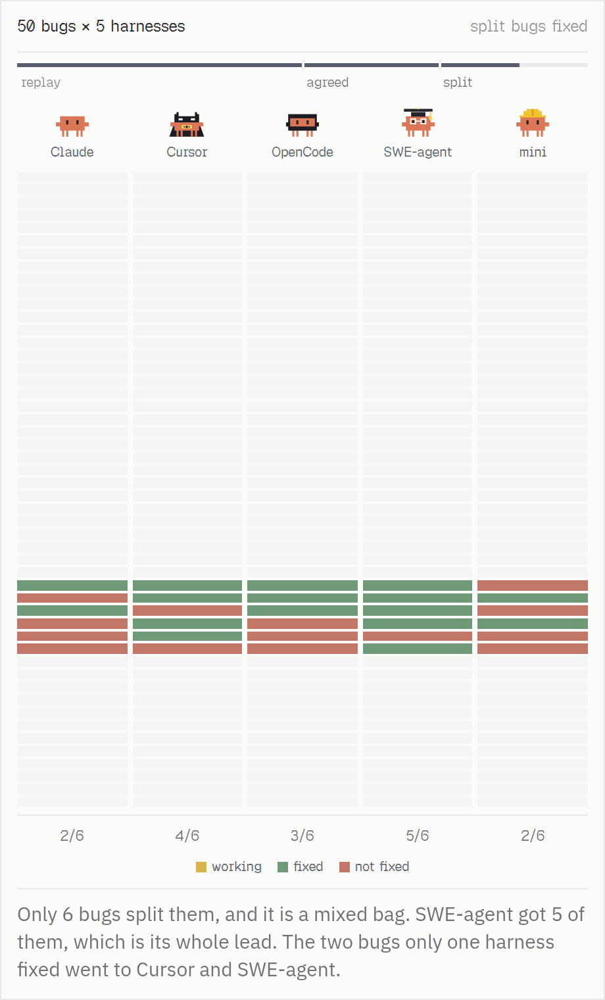
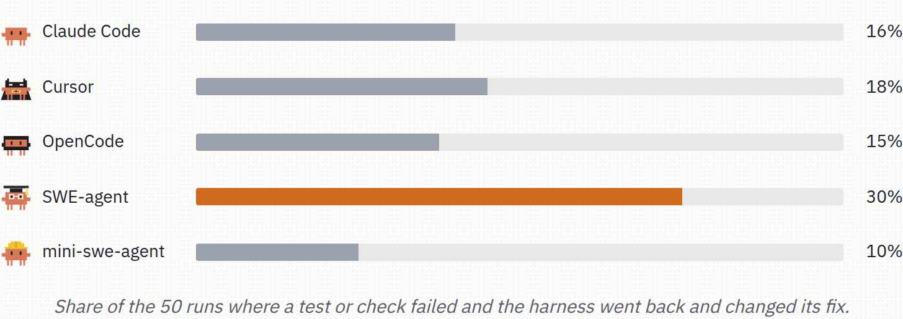

# is your harness lobotomizing your model?

Short answer: no, probably not. The same model, Claude Haiku 5.5, fixes about the same share of bugs in five different coding harnesses. What the harness changes is the bill: tokens, dollars, and minutes per fix.

Same model, same settings, 50 bugs from [SWE-bench Verified](https://www.swebench.com/). The scrolling version of this write-up, which these figures are taken from, is at **[bicrick.com/projects/harness-bench](https://bicrick.com/projects/harness-bench)**.


The little crab is the model. Each outfit is a harness it is wearing.

## The harness fills the window

When a new model comes out, people line the models up and argue about which is smartest. You never talk to the model directly. You talk to a harness: the program that decides what the model sees, which tools it may call, and when the run is over.

The model reads one thing, its context window. The harness fills it. It writes the instructions, lists the tools, pastes in the code the model asked for, runs the tests, and pastes the results back in. Every turn adds more. That window is the whole world the model gets.



## Five harnesses, one model

All five ran Claude Haiku 5.5 with extended thinking off and every command auto-approved.



| Harness | What the model is given |
|---|---|
| [Claude Code](https://claude.com/product/claude-code) | Anthropic's own coding agent. A large toolbox: read, search, edit, to-do lists, helpers. |
| [Cursor](https://cursor.com/cli) | The agent from the Cursor editor, run here from the command line. |
| [OpenCode](https://opencode.ai/) | An open-source terminal agent, with about ten tools. |
| [SWE-agent](https://swe-agent.com/) | Princeton's research agent, from the lab behind SWE-bench. A few purpose-built commands to view, search, and edit files. |
| [mini-swe-agent](https://mini-swe-agent.com/) | The same lab's stripped-down agent. A shell, and nothing else. |

## The same 50 bugs

Each harness got the same 50 real bugs from popular open-source projects. The project's own tests decided whether a fix worked. That is 250 runs.



Most rows come out one color all the way across.



32 bugs, every harness fixed. 12 bugs, none of them did. The bug decides more than the harness. Six bugs split the field.



SWE-agent took 5 of those 6, which is its whole lead. Cursor took 4, OpenCode 3, Claude Code and mini-swe-agent 2. Two bugs were fixed by a single harness: Cursor on astropy-14369, SWE-agent on sphinx-8638.

| Bug | Claude Code | Cursor | OpenCode | SWE-agent | mini-swe-agent |
|---|---|---|---|---|---|
| astropy-14369 | | fixed | | | |
| django-13297 | fixed | fixed | fixed | fixed | |
| django-16454 | fixed | | fixed | fixed | |
| matplotlib-25960 | | fixed | fixed | fixed | fixed |
| sphinx-8638 | | | | fixed | |
| sympy-13031 | | fixed | | fixed | fixed |

## A tie on the bugs. A spread on the bill.


The prices in that figure are fractions of a cent. 0.44¢ is $0.0044.

| | Claude Code | Cursor | OpenCode | SWE-agent | mini-swe-agent |
|---|---|---|---|---|---|
| Bugs fixed | 34/50 | 36/50 | 35/50 | **37/50** | 34/50 |
| Pass rate | 68% | 72% | 70% | **74%** | 68% |
| 95% range | 54–79% | 58–83% | 56–81% | 60–84% | 54–79% |
| Tokens per fix | 492k | 379k | 230k | 251k | **105k** |
| Cost per fix | $0.0096 | $0.0093\* | $0.0062 | $0.0080 | **$0.0044** |
| Minutes per fix | **2.1**† | 2.6† | 4.6 | 9.1 | 3.9 |

\* Cursor bills through its own servers, so its traffic never passed the logging proxy. Its cost is estimated from its own usage logs.

† Claude Code and Cursor's minutes come from a second pass that saved every step (`claude_code_nothink2`, `cursor_nothink2`). That pass had fewer very slow runs. Median run time barely moved (Cursor 69s to 68s, Claude Code 61s to 54s), so the lower minutes-per-fix is mostly a quieter machine.

The 95% ranges are Wilson intervals. They sit on top of each other. At 50 bugs, a gap of one to three fixes is well inside the noise. No harness here is clearly more accurate.

Tokens per fix are a different shape: 105k for mini-swe-agent, 492k for Claude Code, about 4.7× for the same accuracy. Most of that gap is the block each harness writes before the model has read any code, then sends again on every turn. mini-swe-agent and SWE-agent open at about 2k tokens and one to three tools. OpenCode opens around 11k, Cursor around 13k, Claude Code around 24k and about 20 tools.

Cost follows that opening, with prompt caching doing a lot of the work (cache hit rates land in the high 80s to mid 90s). mini-swe-agent is the cheap end, at under half a cent a fix. Claude Code spends the most tokens and finishes the fastest on the clock.

## Where SWE-agent's extra fix comes from

SWE-agent is ahead by one bug over Cursor. Running the code after an edit is common to the top of the field, once the logs are complete: SWE-agent does it in 98% of runs, the Cursor rerun in 98%, Claude Code in 96%. OpenCode does it in 76%, mini-swe-agent in 64%.

The difference that shows up in the logs is what happens after a check fails.



SWE-agent went back and changed its fix in 30% of runs. The others did that in 10% to 18%.

sphinx-8638 is the clean example. The other four shipped a patch in the same wrong place and stopped. SWE-agent built a small Sphinx project, applied a similar fix, rebuilt the docs, saw the link still pointed at `#pkg.limit`, threw that patch away with `git checkout`, and found the actual cause (`rolename='obj'` on the variable field). On the reruns, Cursor and Claude Code again ran a check and stopped on the first patch.

That pattern lines up with the extra fixes. It is one to three bugs, on six disagreements, with overlapping intervals. The logs are consistent with "it keeps going after a failed check." They are too thin to prove it. The extraction and the caveats are in [docs/WHY_SWE_AGENT.md](docs/WHY_SWE_AGENT.md).

The model sets the ceiling. The harness decides how much you pay, in money and in time, to reach it.

## What a single pass cannot show

The model samples a different completion every run, so the same harness can fix a bug once and miss it the next time. Each harness had one shot at each bug. A few points of pass rate can be noise, and this sample is too small to rank the five on accuracy. It is plenty to see that the token bill moves when the fix rate does not.

Aider was in an earlier pass and then left out. It is built for a person at the keyboard, and it wants a test command so it can check itself. Run unattended, with neither, it often stopped and asked someone to run the tests. Its score would have measured that setup.

An earlier pass on each harness's default settings is in `results/` and written up in [docs/WHY_HARNESSES_DIFFER.md](docs/WHY_HARNESSES_DIFFER.md) and [docs/SWEBENCH_PILOT.md](docs/SWEBENCH_PILOT.md). Cursor's default "Haiku 5.5" option was a thinking model, and that pass scored 39/50. With thinking off it missed the three tasks it alone had solved (django-10554, django-14376, sphinx-8638). The wider search in those runs came from the reasoning.

## Setup

- **Model.** Claude Haiku 5.5 for all five. Four harnesses call Anthropic through a logging proxy (`sbr/proxy.py`). Cursor uses its "Haiku 5.5 High, no thinking" option on its own servers.
- **Thinking.** Off everywhere. The proxy forces `thinking` disabled and strips effort settings.
- **Approvals.** Every command auto-approved. The runs are unattended.
- **Budget.** $0.50 per bug per harness, enforced by the proxy. 50 turns where the harness has a turn limit. 30 minutes of wall clock.
- **Machine.** Each run in its own SWE-bench task container, 2 CPU and 4 GB, three runs at a time.
- **Grader.** The official SWE-bench evaluator. A harness that never reaches the model is logged as an error and retried, and that row stays out of the score.
- **Defaults otherwise.** Shipped settings, no per-harness tuning. The box-level fixes made while the runs were going are in [docs/DEVIATIONS.md](docs/DEVIATIONS.md).
- **The 50.** Pinned in `results/swebench/subset.json`. `psf__requests-2317` was swapped for `psf__requests-1142`, for every harness, because its tests call httpbin.org and this machine could not reach it.

## Reproduce

A Linux x86_64 VM with Docker, 60 GB free, and an Anthropic API key. Cursor's column also needs a Cursor API key. The long version is [swebench/README.md](swebench/README.md).

```bash
git clone https://github.com/bicrick/harness-bench && cd harness-bench
SBR_TOOLS=$HOME/sbr-tools bash swebench/setup_tools.sh
export SBR_TOOLS=$HOME/sbr-tools ANTHROPIC_API_KEY=... CURSOR_API_KEY=...
make preflight   # checks the VM, Docker, and keys; one test call
make run         # 50 bugs x 5 harnesses, resumable
make report      # results/swebench/summary.md
```

## Layout

```
sbr/        benchmark runner: harness adapters, logging proxy, budget, grading, report
scripts/    analysis and figures (tokens, why the harnesses differ, the SWE-agent extraction)
swebench/   VM checks and tool setup
results/    raw results: results.jsonl, per-run logs, patches, and grades
docs/       methodology, deviations, analyses, harness notes
docs/media/ stills and loops from the project write-up, used above
figures/    charts from the earlier default-settings pass
tools/      orchestration and the dashboard used during the runs
archive/    the earlier context-shaping pilot (see archive/README.md)
```
