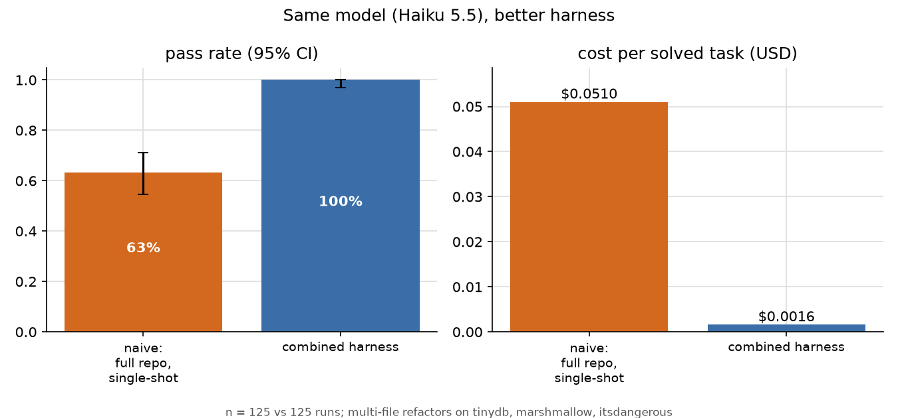
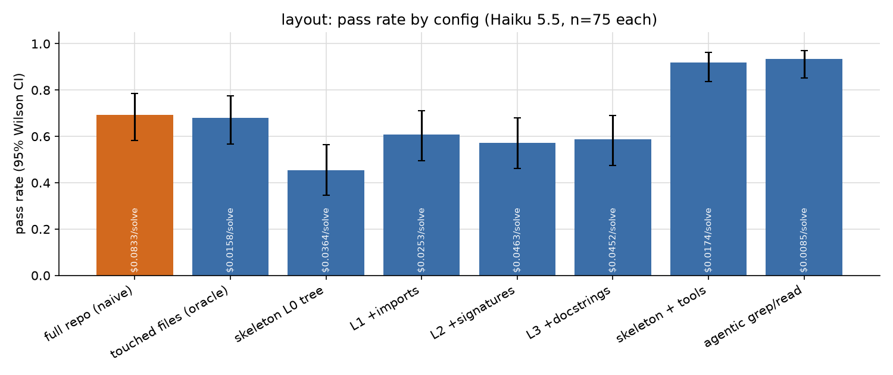
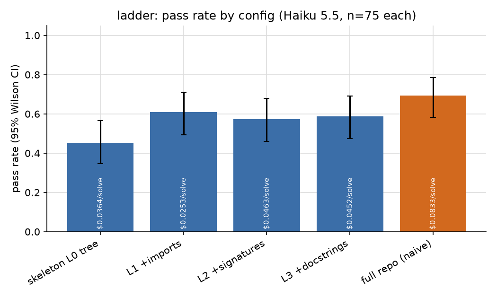
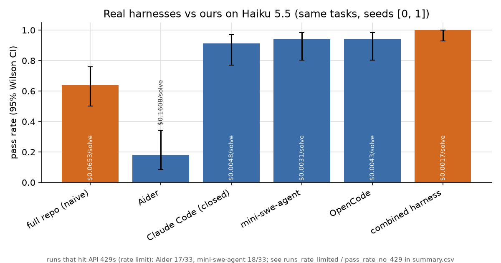

Same model. Same 25 multi-file refactors. I changed nothing but the harness, the code wrapped around the model, and Claude Haiku 5.5 went from passing 63% of runs to passing 100%.

The better harness was also cheaper. Cost per solved task fell from $0.0510 to $0.0016, roughly 1/32 of what the naive setup paid.

No bigger model, no fine-tuning, no clever prompt. Just different decisions about what the model gets to see and what it gets to do.

## Why I cared

I spend a lot of time with coding agents, and most of the conversation around them is about models. Which one is smartest, which one tops the leaderboard this week, which one is worth paying for.

But a model never sees your repo. It sees whatever the harness puts in front of it.

The harness decides which files go into the prompt, which tools exist, what happens when the context window fills up, and whether there's a note telling the model how to approach the job. Every agent product makes those calls differently. I wanted to know how much they matter when you hold the model still.

So I picked one cheap model and made every one of those decisions a switch.

## What I went looking for

I started by reading how the tools people actually use handle context.

**Claude Code** explores on demand with grep, glob and file reads, loads a CLAUDE.md file up front, and compacts (summarizes the conversation to free up space) near the context limit. **Cursor** pairs grep with semantic search over its own embedding index. **Aider** ships an always-on repo map: a skeleton of the codebase, built with tree-sitter and ranked with PageRank, so the model sees the shape of the code without the full text. **Codex CLI** compacts at 90% of the window. **Gemini CLI** does it at 50%.

Those are real design bets: search vs. index, skeletons vs. exploration, early compaction vs. late. And most of these tools still find usages of a symbol with grep or the shell.

Before the main runs I wrote down seven hypotheses. The ones that matter here:

- Showing the model only the right files beats dumping in the whole repo.
- More skeleton detail (signatures, docstrings) helps.
- Agent loops beat any single-shot prompt.
- Structured tools beat raw grep at equal or lower cost.
- Dropping old tool output beats summarizing, and summarizing early is worse than late.
- Stacking the best choices gives at least +20 points at lower cost.

## How I tested it

**The tasks:** 25 refactors on three small Python libraries: tinydb, itsdangerous and marshmallow. Mostly renames of a class, function or method, plus a signature change and a few moves. Six of them are a hard tier I added once agents started acing everything: ambiguous names, a method with 80 call sites across 8 files, and an exception class referenced on 468 lines across 19 files.

**The grader:** a run passes only if the repo's tests pass, no references to the old name remain, and a task-specific check passes. Every leftover reference counts as a *missed caller*. That's the failure you care about in real life: the rename compiles in the files you touched and breaks somewhere you didn't look.

**The model:** Claude Haiku 5.5 only, every run costed from its logged tokens.

**The setups**, one variable at a time:

- **Context layout:** the whole repo in one prompt (the naive baseline), only the files the reference solution touches (a cheat, basically), a skeleton ladder from bare file tree up to imports, signatures and docstrings, and agent loops that explore on their own.
- **Tools:** raw grep/read/edit vs. purpose-built `find_references` and `rename_symbol` tools that understand Python's syntax tree.
- **Compaction:** none, summarize at 50% or 90% of a context budget, or just drop old tool outputs.
- **A skill file:** a five-step refactor procedure, or a generic AGENTS.md conventions doc.

Then I ran four real harnesses on the same tasks: Claude Code, OpenCode, mini-swe-agent and Aider.

1,632 graded runs in total. $28.53 in API spend.

## What happened

### 1. More context didn't fix it

My first hypothesis died fast. The whole repo in one prompt passed 69% in the main runs. Showing the model *only* the files it needed to change passed 68%.

Giving it the answer key on where to look made no difference.

The problem wasn't finding the files. It was writing every edit correctly in one pass. 77% of single-shot failures were missed callers, and with the full repo in the prompt, the files it forgot to update were sitting right there in front of it.

On the `Table.insert` rename, which touches 80 call sites, the full-repo prompt left 37 references behind in one run.

**Takeaway: the model doesn't need to see more. It needs a way to check its work.**

### 2. Skeletons alone fall flat

Repo maps are a popular idea, so I built a ladder. A bare file tree passed 45%. Adding imports got it to 61%. Adding signatures (57%) and docstrings (59%) did nothing more.

Bolting a skeleton onto an agent loop didn't help either. The loop with a skeleton up front passed 92%, the loop without one passed 93%, and the skeleton doubled cost per solve ($0.0174 vs $0.0085).

On repos this small, extra structure just makes the prompt longer.

**Takeaway: a map helps a single-shot model a little. It can't replace letting the model look around.**

### 3. The loop and a real tool did the heavy lifting

Two changes carried this whole project.

The first is the loop. Let the model grep, run the tests and look again, and pass rate jumps from 69% at best (single shot) to 93% for a plain agent with grep, read and edit.

The second is the tool. Same loop, same prompt, but swap grep for `find_references` and `rename_symbol`. Pass rate went to 97%, cost per solve dropped from $0.0085 to $0.0016 (5.2x cheaper), and the agent made 4.3x fewer tool calls (9.2 vs 39.2 per run).

That 93% vs 97% gap on its own is within the noise. The story is in the hardest task.

Renaming marshmallow's `ValidationError` means changing 468 lines across 19 files. Here's what happened:

The grep agent went 0 for 3. Doing that rename with grep means hundreds of tiny find-and-edit steps. All three runs burned through the 25 model turns the harness allows. They averaged 451 tool calls each. The prompt ballooned to as much as 122,762 tokens, because every grep result and file read gets carried forward into the next call.

The agent with structured tools went 3 for 3. About 8 tool calls. Its prompt never went past 9,785 tokens.

Same model. One of them drowned in its own search results. The other asked "where is this used?", got an exact answer, and renamed it.

My favorite moment came from a single-shot skeleton run on the same task. The model didn't even try. It explained that writing every occurrence as an edit block "would mean reproducing most of the codebase" and handed me a `grep | xargs sed` one-liner to run myself.

It was right. A mechanical rename is the reliable way to do it. That's exactly the move a `rename_symbol` tool puts inside the harness.

**Takeaway: give the model the operation, not the raw materials.**

### 4. Compaction backfired, and the prompt cache is why

At a 24k-token budget, compaction barely fired, and every variant landed within a point of no compaction. So I squeezed the budget to 12k.

Then they separated. Summarizing at 50% fired 6.6 times per run, dropped to 79% and cost $0.0397 per solve. Summarizing at 90% held 88%. Simply dropping old tool outputs held 93% at $0.0143, the best and cheapest of the three.

The hidden cost is the prompt cache. Providers give you a big discount when the start of your prompt matches what they've seen before. Every summary rewrites that start. Summarizing at 50% dropped the cache hit rate to 10%, against 85% with no compaction.

So early summarization didn't just lose information. It also threw away the discount on every call after it.

**Takeaway: if you must compact, drop stale tool output first and do it late.**

(The skill file, if you're wondering, was a cost win, not an accuracy win: 93% either way, with cost per solve down from $0.0085 to $0.0080. The generic AGENTS.md doc passed 91% and cost more.)

### 5. The real-harness scoreboard

Stacking the winners (agent loop, structured tools, no compaction, the skill file) gave the combined harness. It passed all 125 runs in the final head-to-head. On the hard tier in the main runs, the naive prompt passed 28% and the loop with structured tools passed 100%.

Then I put real tools on the same tasks, all on Haiku 5.5, all costed and graded the same way:

- Combined harness: 100%, $0.0017 per solve
- OpenCode: 94%, $0.0043
- mini-swe-agent: 94%, $0.0031
- Claude Code: 91%, $0.0048
- Naive full repo: 64%, $0.0653
- Aider (headless, single message): 18%, $0.16

The autonomous agents all land in the low-to-mid 90s for a fraction of a cent. That's far above the naive setup and a little below a harness built for exactly this one job. Claude Code cost 2.8x more per solve than the combined harness. My guess is that's the price of being general-purpose, but I didn't measure it.

Aider needs a fair note. In headless mode it only edits files its repo map pulled into the chat, and on one rename it ended by asking me to "add them to the chat and I'll update them." It's built for a human in the loop. With nobody there, missed callers are what you'd expect. This isn't a verdict on Aider as people actually use it.

**Takeaway: the general-purpose agents are good. A task-specific tool still beat them all.**

## What this means if you build agents

1. **Ship semantic tools for the operations your model repeats.** Find references, rename symbol, replace-all with match counts. Grep vs. a real find-references tool was the biggest gap I measured.
2. **Let the agent explore instead of pre-loading context.** Whole-repo prompts and skeletons cost more and helped less.
3. **Protect the prompt cache.** If you compact, drop old tool output before you summarize, trigger late, and keep the start of the prompt stable.
4. **Keep procedure notes short and specific.** A five-step skill trimmed wasted steps. A generic conventions file didn't earn its tokens.

## The honest caveats

- **Small tasks.** 25 refactors on three small Python repos, written by me, mostly renames. On big repos, retrieval and skeletons may matter more.
- **One model.** Haiku 5.5 always uses extended thinking. Other models may react differently.
- **Same tasks for picking and testing.** The combined config was chosen with a rule fixed in advance, but on the same 25 tasks, so 100% is optimistic.
- **Strict grading.** The grader counts leftover names in comments too. Grade code only and the naive harness rises from 63% to about 75%. The lift shrinks to about 25 points. Still big.
- **The real-harness numbers are a partial seed.** I hit my monthly API usage limit partway through the second seed, so most cells have one seed, and some runs hit rate-limit retries.
- **The bill:** $28.53 for everything, including runs I killed and restarted.

## The close

Everyone's arguing about which model to use. Fair enough. But on these tasks, the same cheap model swung from 63% to 100% based on decisions that live entirely outside it.

Before you upgrade your model, check what your harness is feeding it.

Every task, run log, transcript and figure is in the repo, along with one command to rebuild every number for $0: [github.com/bicrick/context-shaping](https://github.com/bicrick/context-shaping).
