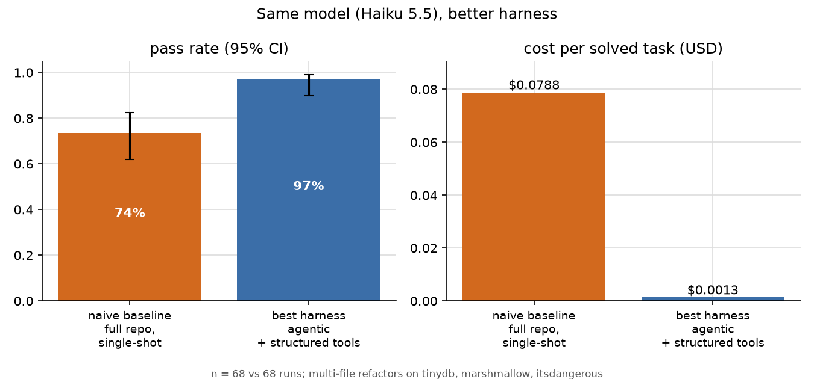
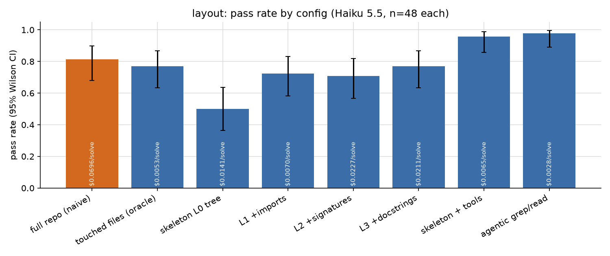
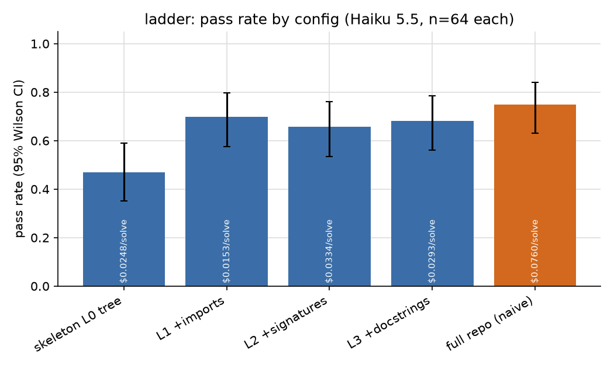
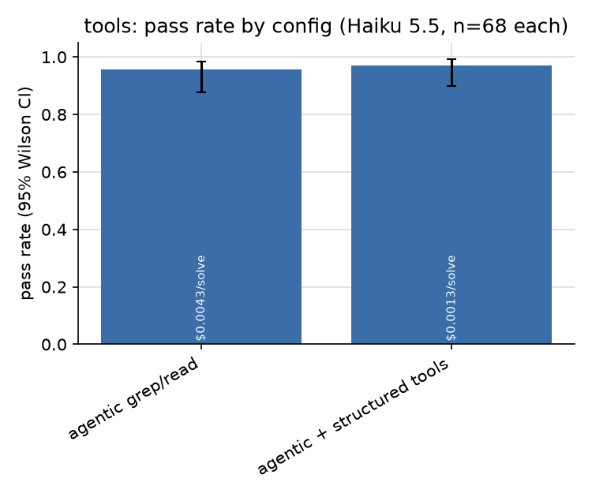
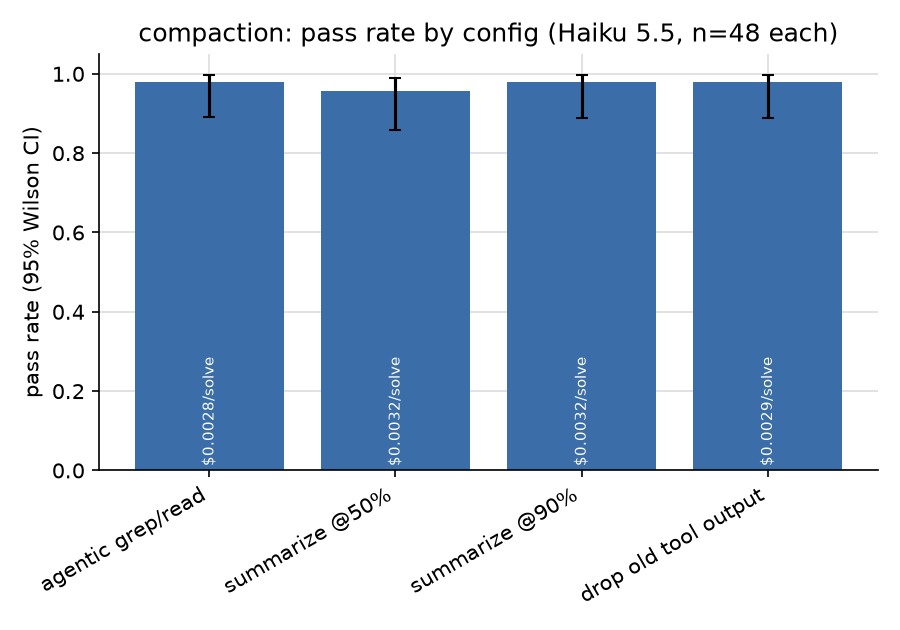
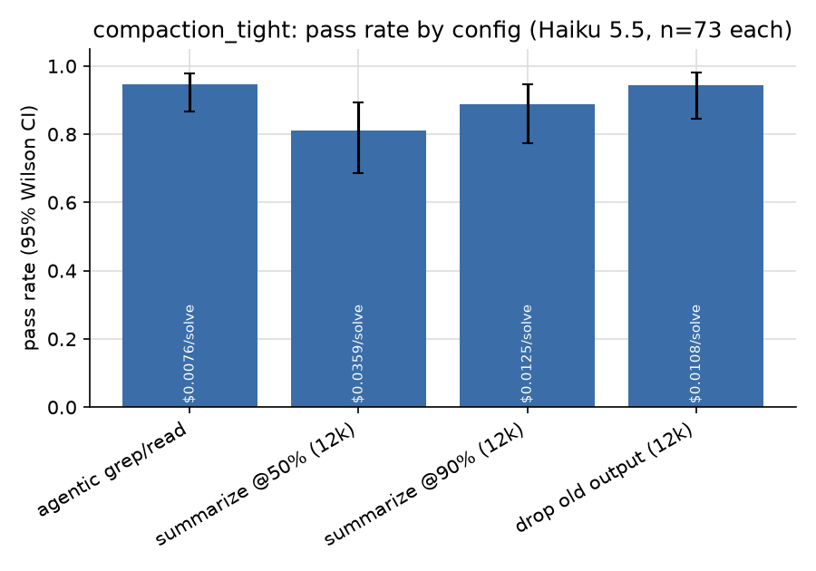
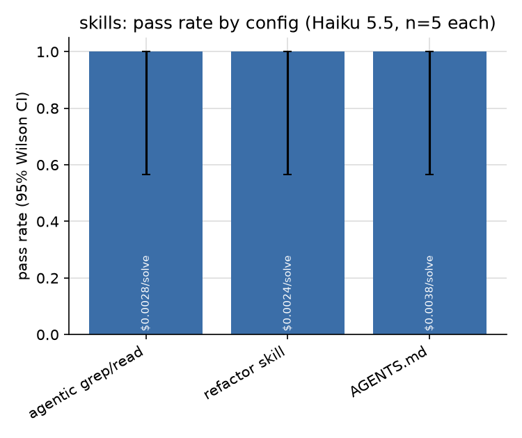
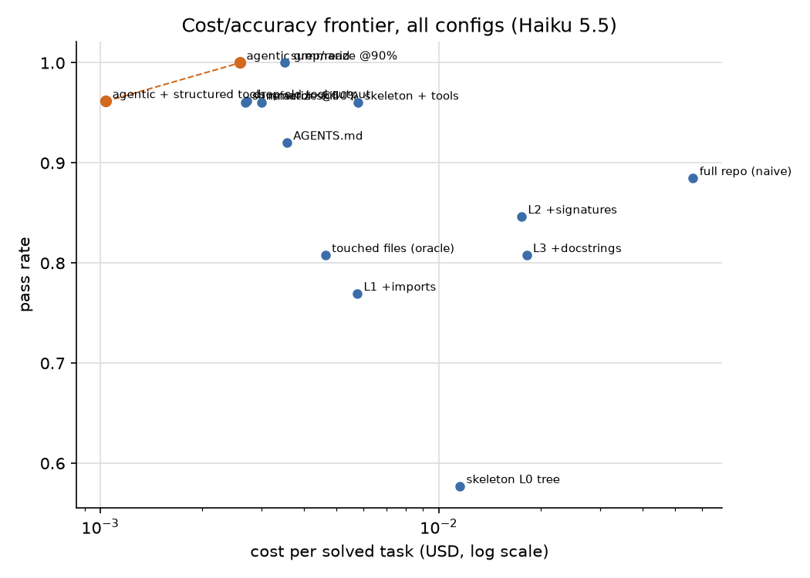
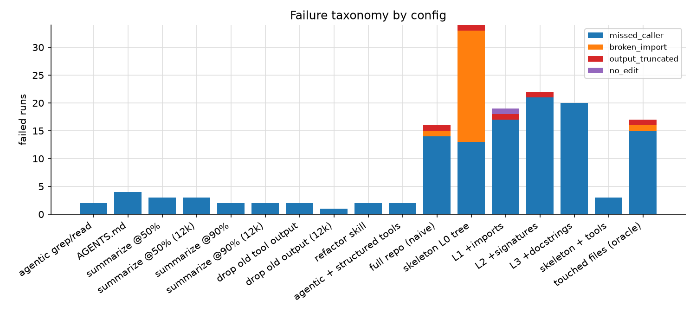
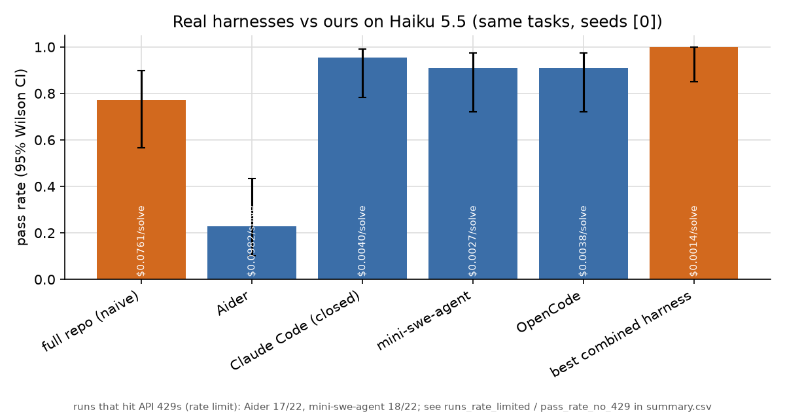

# Same model, better harness

*How far can context management and tool design push a cheap model on multi-file refactors? I held Claude Haiku 5.5 fixed and changed only the harness.*

**Same model, same {{n_tasks}} tasks: the naive harness passed {{hl.base}} of runs, and the best harness passed {{hl.best}}. That's +{{hl.lift}} points, and cost per solved task dropped from {{hl.base_cps}} to {{hl.best_cps}}, about {{hl.ratio}}x cheaper.**



*Final run, {{hl.n}} runs per arm ({{n_tasks}} tasks × {{n_seeds_final}} seeds). The 95% Wilson intervals are {{hl.base_ci}} for the naive harness and {{hl.best_ci}} for the combined one.*

People argue a lot about which model writes the best code. I wanted to measure the other half: everything around the model. That's what goes into the context window, which tools the model gets, what happens when the context fills up, and whether a short how-to note helps. I picked one cheap model, wrote a small harness where each of those choices is a switch, and ran {{total_runs}} graded runs for {{ledger}} in API spend.

The short version: on this kind of task, the harness matters more than I expected, and one choice (a real find-references tool instead of grep) does most of the work.

## The setup

**Tasks.** {{n_tasks}} refactors on three small, pinned, pure-Python libraries: tinydb ({{tasks.tinydb}} tasks), itsdangerous ({{tasks.itsdangerous}}) and marshmallow ({{tasks.marshmallow}}). Most are renames of a class, function or method, plus a signature change, function moves and a module move. {{n_hard}} of them form a hard tier I added once the agents started hitting the ceiling. That tier has ambiguous names (renaming `Table.search` while unrelated `search` methods must survive), a method with 80 call sites across 8 files, and an exception class with 468 references across 19 files.

**Grader.** A run passes only if three things hold: the repo's tests pass, no references to the old name remain (each leftover counts as a *missed caller*), and a task-specific check passes. Every task has a reference solution that passes the grader, and the unmodified repo fails it (`python -m cshape verify`).

**Model and cost.** Only `claude-haiku-5-5`, with prompt caching on, and every run costed at list price from its logged token counts. A hard cap in the harness refuses API calls past $50.

**What I varied** (one arm at a time, with plain grep/read/edit as the agentic base):

- **Context layout:** the whole repo in one prompt (`full`, the naive baseline), only the files the reference solution touches (an oracle), a skeleton ladder from file tree (L0) to imports (L1), signatures (L2) and docstrings (L3), and agent loops that explore on their own.
- **Tool design:** raw `grep` / `read_file` / `edit` vs structured `find_references` (AST-aware, grouped into definitions, imports, code and comments), `rename_symbol` with a dry-run preview, and a replace-all edit that reports match counts.
- **Compaction:** none, summarize at 50% or 90% of a context budget, or drop old tool outputs. I ran it at a 24k budget and again at 12k.
- **Procedural context:** nothing, a five-line refactor skill ("find all references, change, test, search again, then finish"), or an AGENTS.md-style conventions doc.

I wrote down seven hypotheses before the main runs (`docs/HYPOTHESES.md`) and fixed the rule for building the combined config in advance: for each arm, take the option with the highest pass rate, and break ties on cost. That rule picked **{{choice}}**. The combined config then got a fresh final run against the naive baseline, {{n_seeds_final}} seeds on every task.

## Finding 1: showing the model the right files doesn't fix single-shot



Every single-shot layout tops out around {{best_single}}. The naive full-repo prompt passed {{main.full.pass}}, and the oracle that sees only the touched files passed {{main.touched.pass}}. Seeing the right files isn't the problem. The problem is writing every edit correctly in one pass, and {{single.missed_share}} of single-shot failures are missed callers. The model sees the call site and still doesn't change it.

The two agent loops, which can grep, run the tests and look again, land at {{main.agentic.pass}} (`agentic`) and {{main.skel_retrieval.pass}} (`skeleton + tools`). Giving the agent an L2 skeleton up front bought nothing on pass rate, and it doubled cost per solve ({{main.skel_retrieval.cps}} vs {{main.agentic.cps}}).



The skeleton ladder mostly shows that a bare file tree is not enough: L0 passed {{main.skel_L0.pass}}. Adding imports (L1, {{main.skel_L1.pass}}) helped. Signatures (L2, {{main.skel_L2.pass}}) and docstrings (L3, {{main.skel_L3.pass}}) did not help further. On these small repos, the extra detail just made the prompt longer.

## Finding 2: a real find-references tool is the biggest single lever



Same agent loop and same prompt; only the tools changed. Raw grep/read/edit passed {{main.agentic.pass}} at {{main.agentic.cps}} per solve. With `find_references` and `rename_symbol` it passed {{main.agentic_tools.pass}} at {{main.agentic_tools.cps}}, which is {{tools.ratio}}x cheaper. The structured agent also made {{tools.callratio}}x fewer tool calls ({{main.agentic_tools.tools}} vs {{main.agentic.tools}} per run).

The pass-rate gap is inside the confidence intervals over all tasks. It shows up clearly on the biggest refactor, though. On the 468-reference `ValidationError` rename, the grep agent passed {{h03.agentic}} and the structured agent passed {{h03.agentic_tools}}. Doing that rename with grep means hundreds of small edits. All {{h03.agentic.capped}} grep-agent runs hit the 25-step cap, averaging {{h03.agentic.calls}} tool calls, and the prompt grew to as much as {{h03.agentic.peak}} tokens. The structured agent finished in about {{h03.agentic_tools.calls}} calls, and its prompt never went past {{h03.agentic_tools.peak}} tokens.

The cost drop is about more than fewer calls. Each grep-and-read step adds tool output that later calls carry along as context. A tool that answers "where is this used?" exactly keeps the context small and focused on the task.

## Finding 3: compaction only matters when it fires, and then summarizing early hurts



At a 24k-token budget, compaction barely triggered (about {{main.agentic_c50.comp}} compactions per run for summarize-at-50%, {{main.agentic_c90.comp}} for summarize-at-90%). All four variants landed within a few points of each other ({{main.agentic_c50.pass}}, {{main.agentic_c90.pass}}, {{main.agentic_mask.pass}} vs {{main.agentic.pass}} with no compaction), so I re-ran them at 12k.



At 12k the variants separate. Summarizing at 50% averaged {{main.agentic_c50_tight.comp}} compactions per run and fell to {{main.agentic_c50_tight.pass}} at {{main.agentic_c50_tight.cps}} per solve. Summarizing at 90% held {{main.agentic_c90_tight.pass}}. Simply dropping old tool outputs held {{main.agentic_mask_tight.pass}} at {{main.agentic_mask_tight.cps}}, the best result of the three at the lowest cost. That matches the pre-registered hypothesis.<!-- TODO(verify): cite JetBrains 'The Complexity Trap' (arXiv 2508.21433) here only after re-reading it; PRIOR_WORK marks it [verify]. --> Each summary rewrites the prompt prefix, so the cache hit rate collapsed to {{main.agentic_c50_tight.cache}} for summarize-at-50%, versus {{main.agentic.cache}} with no compaction. Rewriting the prefix costs real money.

## Finding 4: a five-line skill is a cost win, not an accuracy win



The refactor skill passed {{main.agentic_skill.pass}}, the same as no skill ({{main.agentic.pass}}). It did cut cost per solve from {{main.agentic.cps}} to {{main.agentic_skill.cps}}, which is why the selection rule kept it. The generic AGENTS.md conventions doc passed {{main.agentic_agentsmd.pass}} and cost more ({{main.agentic_agentsmd.cps}}). A specific procedure beat general advice, but neither changed much.

## Where the configs separate: the hard tier

{{tier_table}}

*Main runs. Base = the {{n_base}} original tasks, hard = the {{n_hard}} hard-tier tasks.*

On the base tasks, any agent loop scores in the 90s, and the configs look interchangeable. The hard tier pulls them apart. High fan-out renames break single-shot outright, and the grep agent slips on the largest one.

## The frontier



Plotting every config by cost per solve against pass rate, the combined harness is the only point on the frontier. Nothing else is both cheaper and more accurate. Agentic + structured tools sits just below it, and everything single-shot is in the expensive, inaccurate corner.

In the final head-to-head, the naive harness failed every seed on {{full_zero_tasks}} of {{n_tasks}} tasks and passed every seed on {{full_perfect_tasks}}. The combined harness passed all {{final.combined.n}} runs.

<details><summary>Per-task results, final run</summary>

{{final_task_table}}

</details>

## How the runs failed



Every failed run gets an automatic tag from the grader output and the transcript.

{{failure_table}}

Here are four real examples from the logs.

**Missed callers (naive, full repo).** Renaming `Table.insert` to `insert_document` means touching 80 call sites. In the final run (seed {{ex.h02.seed}}), the full-repo prompt left {{ex.h02.missed}} references behind. Here are the first few:

```
{{ex.h02.refs}}
```

**Giving up (L3 skeleton, 468-reference rename).** Single-shot SEARCH/REPLACE output hits the 16k output cap on the biggest rename. In one run (seed {{ex.giveup.seed}}) the model didn't attempt the edits at all. It explained why and handed back a `grep | xargs sed` one-liner for me to run instead:

{{ex.giveup}}

That's a sensible answer, and it's exactly the move a `rename_symbol` tool makes available inside the harness.

**Missed caller, or a grader that's too strict? (agent with AGENTS.md).** The grader counts every whole-word match of the old name, comments included. Here the leftover was `{{ex.freeze.ref}}`, which uses "freeze" as a verb, and the agent said so (seed {{ex.freeze.seed}}):

{{ex.freeze}}

I count that as a fail because the task asks for zero matches and the reference solution manages it, but the agent's reading is reasonable. The limitations section shows how much the headline depends on this.

**Waiting for a human (Aider).** In headless single-message mode, Aider edits only the files its repo map pulled into the chat. On the `LRUCache` rename it left {{ex.aider.missed}} missed callers and ended with:

{{ex.aider}}

That's not a bug in Aider. It's built for a person in the loop who adds files when asked. With nobody there, missed callers are what you'd expect.

## Real harnesses on the same tasks



I ran four real harnesses headless on Haiku 5.5, behind a logging proxy so all of them are costed the same way and graded by the same grader: Claude Code (closed source, as a reference), OpenCode, mini-swe-agent and Aider.

| Harness | Pass rate | n | Cost per solve |
|---|---|---|---|
| Combined harness (same seeds) | {{panel.combined.pass}} | {{panel.combined.n}} | {{panel.combined.cps}} |
| OpenCode | {{arme.ext_opencode.pass}} | {{arme.ext_opencode.n}} | {{arme.ext_opencode.cps}} |
| mini-swe-agent | {{arme.ext_mini_swe_agent.pass}} | {{arme.ext_mini_swe_agent.n}} | {{arme.ext_mini_swe_agent.cps}} |
| Claude Code | {{arme.ext_claude_code.pass}} | {{arme.ext_claude_code.n}} | {{arme.ext_claude_code.cps}} |
| Aider (single-message mode) | {{arme.ext_aider.pass}} | {{arme.ext_aider.n}} | {{arme.ext_aider.cps}} |
| Naive full repo (same seeds) | {{panel.full.pass}} | {{panel.full.n}} | {{panel.full.cps}} |

The good general-purpose agents land in the low-to-mid 90s for a fraction of a cent per solve. That's well above the naive harness, and a little below a harness built for this one job. Claude Code cost {{arme.cc_vs_combined}}x more per solve than the combined harness on matching seeds. My guess is that's the price of being general, with a bigger system prompt and tools for everything rather than just renames, but I didn't measure it. Aider's low score comes from the human-in-the-loop design described above, not from the model. Counting only its {{arme.ext_aider.n_no429}} runs with no rate-limit errors, it still passed just {{arme.ext_aider.no429}}.

Treat these numbers as indicative. Most cells have one seed. A second seed was partway through when my Anthropic account hit its monthly usage limit, so some cells have two seeds and most have one. Some runs also overlapped heavy traffic from the main experiment and saw 429 retries ({{arme.ext_mini_swe_agent.rl}} of mini-swe-agent's runs and {{arme.ext_aider.rl}} of Aider's).

## How this maps to the tools people actually use

From my notes on each tool (`docs/research/`):

- **Claude Code** explores on demand with grep, glob and read, loads CLAUDE.md up front, compacts near the context limit, and clears old tool results. That's close to the "agent loop + drop old tool output" corner that did well here.
- **Cursor** pairs grep with semantic search over its own embedding index. Cursor reports that the combination beats grep alone, with bigger gains on repos of 1,000+ files. My repos are small, which probably understates the value of retrieval. I didn't run Cursor; it isn't in the headless panel.
- **Aider** is the main tool that ships an always-on skeleton (a tree-sitter repo map ranked with PageRank). My skeleton ladder suggests a map helps a single-shot model a little but can't replace a search loop.
- **Codex CLI** compacts at 90% of the window and **Gemini CLI** at 50%. At a tight budget in my runs, the earlier trigger cost the most and passed the least.
- **SWE-agent**'s classic setup keeps only the last few tool outputs (observation masking). That's the cheapest kind of compaction, and it was the strongest variant here.

Most of these tools find usages with grep or the shell. Where symbol-aware tooling exists, it tends to be an add-on (Claude Code's LSP plugins, for example). I didn't audit every tool's defaults, so take that as a pattern rather than a census. For a cheap model doing refactors, the jump from grep to a real find-references tool was the biggest single gain I measured.

## What I'd build into a harness, based on this

1. Give the model semantic tools for the operations it repeats: find references, rename symbol, replace-all with counts. Don't make it do those with grep.
2. Let the agent explore instead of pre-loading context. Skeletons and whole-repo prompts cost more and helped less.
3. If you have to compact, drop old tool output before you summarize, and trigger late. Keep the prompt prefix stable so the cache keeps working.
4. A short task-specific procedure is cheap and trims wasted steps. A generic conventions file didn't earn its tokens.

## Pre-registered hypotheses: how they held up

- **H1 (the oracle beats the naive full-repo prompt):** not supported. Touched files passed {{main.touched.pass}} and the full repo passed {{main.full.pass}}. Full repo was the most expensive config ({{main.full.cps}} per solve).
- **H2 (pass rate rises from L0 to L2):** partly. L0 to L1 was the big step ({{main.skel_L0.pass}} to {{main.skel_L1.pass}}), and L2 and L3 added nothing.
- **H3 (agent loops beat every single-shot layout):** supported, {{main.agentic.pass}} and {{main.skel_retrieval.pass}} vs at most {{best_single}}. The skeleton did not reduce tool calls ({{main.skel_retrieval.tools}} vs {{main.agentic.tools}}).
- **H4 (structured tools beat raw tools at equal or lower cost):** supported on cost ({{tools.ratio}}x) and on the hardest task. The overall pass-rate gap is within noise.
- **H5 (dropping tool output beats summarizing; 50% is worse than 90%):** supported at the 12k budget, untestable at 24k.
- **H6 (a skill file helps more than AGENTS.md):** partly. The skill beat AGENTS.md but matched no skill on pass rate, and won only on cost.
- **H7 (+20 points or more at lower cost):** supported, +{{hl.lift1}} points at {{hl.ratio}}x lower cost per solve.

## Limitations

- **Small, author-made tasks.** {{n_tasks}} refactors on three small Python repos, written by me. Renames dominate. Retrieval and skeletons may matter more on large repos, and other kinds of edits may favor other configs.
- **The combined config was chosen on the same tasks it was tested on.** The final run was a separate run, but it used the same {{n_tasks}} tasks, so {{final.combined.pass}} is optimistic. The selection rule was fixed in advance, which limits the damage but doesn't remove it.
- **The grader is strict about comments.** If I grade only code (tests pass, check passes, no leftover reference outside comments and strings), the naive harness rises from {{hl.base}} to {{len.full}} ({{len.full.comment_only}} of its failures were comment-only), and the combined harness stays at {{len.combined}}. The lift shrinks to about {{len.lift}} points but is still large.
- **One model.** Haiku 5.5 always uses extended thinking. A model without it, or a bigger one, could respond differently to the same harness changes.
- **Arm E is thin.** Mostly one seed, a partial second seed, out-of-the-box settings, and some rate-limit noise (see above).
- **Bookkeeping.** The ledger shows {{ledger}} spent, and the per-run logs (including retried and duplicate rows) account for {{recon.logged}}. The remaining {{recon.gap}} is API spend from runs I killed and restarted during the night, which never wrote a row. {{dup.rows}} runs were logged twice by overlapping jobs ({{dup.cost}}); the stats keep one copy of each. One cell (L1 skeleton, one marshmallow task, seed 0) is missing, so that config has n={{main.skel_L1.n}}.

## What's next

- **A SWE-bench Verified subset** to check whether the tool-design result holds on real bug fixes. It needs Docker, which this box doesn't have yet.
- **Bigger repos**, where retrieval should start to pay off, and RefactorBench-style tasks I didn't write myself.
- **The RL-environment angle.** Each task plus its grader is a small, cheap environment. "Missed callers" is a dense, verifiable signal instead of a single pass/fail bit, and an episode with the combined harness costs about {{final.combined.cps}}. That is enough to train a policy on harness behavior, not just evaluate it.

## Reproduce it

```bash
make reproduce   # every run in this article (needs ANTHROPIC_API_KEY; I spent {{ledger}} including restarts; hard-capped at $50)
make figures     # rebuild every number, chart and this article from the committed logs, $0
```

Every number in this article is filled in by `python -m cshape.article` from `results/article_numbers.json` and `results/article_extras.json`, which are rebuilt from the raw run logs in `results/*.jsonl`. Full transcripts for all {{total_runs}} runs are in `results/transcripts/`.
