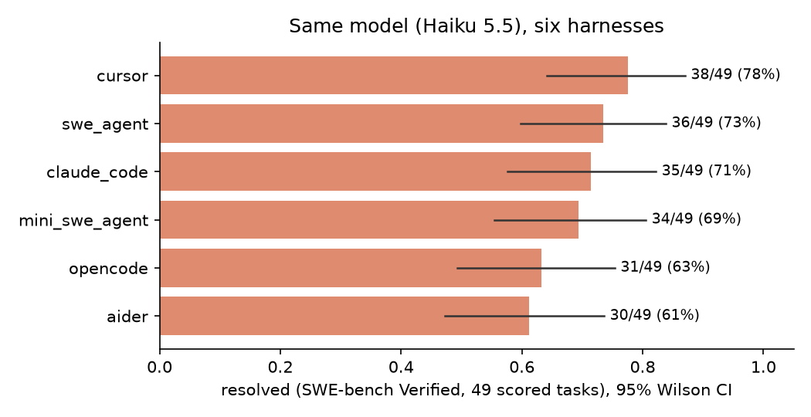
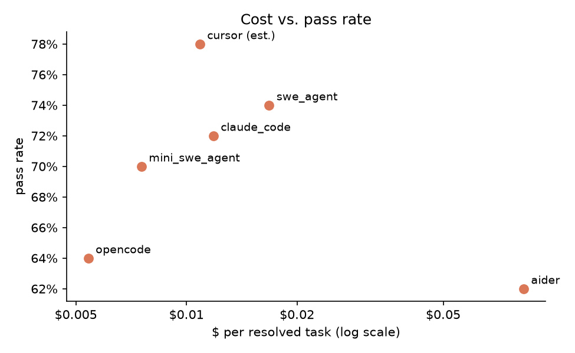
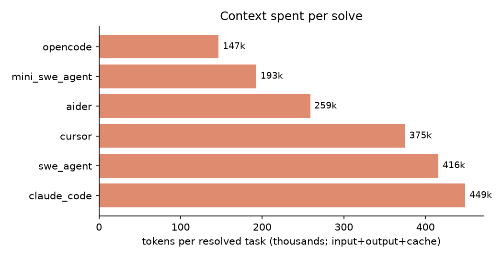

# SWE-bench Verified: 6 harnesses x 50 tasks (claude-haiku-5-5)

## Same settings: the result (finished 2026-10-11 19:44 CDT)

### Playing field

An audit of the default-settings run found that the harnesses were not all running the model the same way. Haiku 5.5 thinks adaptively by default, so the five harnesses that go through the cost proxy (SWE-agent, Claude Code, mini-SWE-agent, OpenCode, Aider) were all thinking, by default or through an explicit effort setting, while Cursor's original run used a thinking variant too and its rerun used Cursor's "No Thinking" model. To put every harness on one footing, all six were run on all 50 tasks with thinking off:

| setting | value for all six harnesses |
|---|---|
| model | `claude-haiku-5-5` |
| thinking | off. Proxied harnesses: the proxy forces `thinking={"type":"disabled"}`, drops `output_config.effort`, thinking-clearing context edits and thinking blocks in history. Cursor: `--model claude-haiku-5-5-high` ("Haiku 5.5 High No Thinking") |
| permissions | every tool call auto-approved (OpenCode `"permission": "allow"`; the others already ran unattended) |
| tasks / grader | the pinned 50-task subset, official SWE-bench grader, latest row per pair |
| compute | 3 agent runs box-wide, 2 CPU / 4 GB per container (`slots3_cpus2_mem4g`) for every row |
| context window | Cursor's no-thinking model exposes 300K; the proxied harnesses 1M. No run came close to either limit (largest median peak prompt about 42K, Aider) |

Parity check: all 2,390 proxied calls in the five proxied same-settings runs carry `req.normalized` and 0 thinking blocks; 0 of 50 Cursor stream logs contain a thinking event. One Aider task (sphinx-10466) was rejected by the API on its first request (HTTP 400, 0 billed calls), exactly as in the default run, and counts as an Aider failure.

### Same-settings table (50 tasks each)

| harness | solved | pass rate (95% CI) | $ total | $/solve | tokens/task | tokens/solve | min/solve | cache hit |
|---|---|---|---|---|---|---|---|---|
| SWE-agent | 37/50 | 74% (60-84%) | 0.295 | 0.0080 | 185,477 | 250,645 | 9.1 | 92% |
| Cursor | 35/50 | 70% (56-81%) | 0.325 (est.) | 0.0093 (est.) | 275,038 | 392,911 | 4.9 | 94% |
| OpenCode | 35/50 | 70% (56-81%) | 0.218 | 0.0062 | 161,224 | 230,320 | 4.6 | 92% |
| mini-SWE-agent | 34/50 | 68% (54-79%) | 0.149 | 0.0044 | 71,546 | 105,214 | 3.9 | 87% |
| Claude Code | 33/50 | 66% (52-78%) | 0.336 | 0.0102 | 310,976 | 471,176 | 4.0 | 95% |
| Aider | 26/50 | 52% (39-65%) | 3.476 | 0.1337 | 187,953 | 361,449 | 5.7 | 2% |

Generated by `scripts/swebench_tokens.py` and `scripts/swebench_final.py` (rows `*_nothink`). Pass-rate CIs are 95% Wilson intervals; min/solve is total wall time over solves; Cursor $ is an estimate from its own token logs since it bypasses the proxy.

### Default settings → same settings

| harness | default settings | same settings |
|---|---|---|
| SWE-agent | 37/50 (74%) | 37/50 (74%) |
| Cursor | 39/50 (78%) | 35/50 (70%) |
| OpenCode | 32/50 (64%) | 35/50 (70%) |
| mini-SWE-agent | 35/50 (70%) | 34/50 (68%) |
| Claude Code | 36/50 (72%) | 33/50 (66%) |
| Aider | 31/50 (62%) | 26/50 (52%) |

What it says: on one model with the same settings the harness still moves the score by 22 points (SWE-agent 74% to Aider 52%), and Aider's interval no longer overlaps the top four's point estimates. The top five are within 8 points and their intervals overlap, so they are a statistical tie at n=50. Cost spreads far more than accuracy: Aider pays about $0.134 per solve, about 30x mini-SWE-agent ($0.0044), because it resends repo maps and whole files with almost no cache reuse (2% cache hits versus 87-95% for the others). Turning thinking off cut SWE-agent's tokens per solve by about 40% at the same 37 solves. 24 tasks were solved by all six and 12 by none; Cursor alone solved astropy-14369 and SWE-agent alone solved sphinx-8638.

## Default settings: full run (Stage 2, finished 2026-10-11 06:08 CDT)

Every harness ran the whole pinned 50-task subset (`results/swebench/subset.json`) on `claude-haiku-5-5`, graded with the official SWE-bench harness. psf__requests-2317 was dropped from the subset because its grader needs httpbin.org, which is unreachable from the box. It was replaced by psf__requests-1142 using the subset's existing same-repo swap rule (`sbr/subset.py` EXCLUDE). The rule first drew 1724, 1766 and 1921, which use the same live-httpbin tests, then 2931, whose gold patch fails in this environment. 1142's gold patch resolves offline in 22 s. The other 49 tasks are unchanged. All six harnesses ran 1142 on 2026-10-11 under the fair regime, so every harness is scored on the full 50. Latest good row per pair wins, so the 10 queued old-regime re-runs replace their earlier rows. Generated from `scripts/swebench_tokens.py`, `scripts/swebench_final.py`, `scripts/swebench_pilot_report.py 50`, `python3 -m sbr.report` and `scripts/swebench_figures.py`.

| harness | solved | pass rate (95% CI) | $ total | $/solve | tokens/task | tokens/solve | min/solve* |
|---|---|---|---|---|---|---|---|
| cursor | 39/50 | 78% (65-87%) | 0.424 (est.) | 0.0109 (est.) | 292,662 | 375,207 | 8.6 |
| swe_agent | 37/50 | 74% (60-84%) | 0.622 | 0.0168 | 307,879 | 416,052 | 14.2 |
| claude_code | 36/50 | 72% (58-83%) | 0.426 | 0.0118 | 323,186 | 448,870 | 7.2 |
| mini_swe_agent | 35/50 | 70% (56-81%) | 0.264 | 0.0075 | 135,000 | 192,858 | 5.8 |
| opencode | 32/50 | 64% (50-76%) | 0.173 | 0.0054 | 93,850 | 146,641 | 5.4 |
| aider | 31/50 | 62% (48-74%) | 2.566 | 0.0828 | 160,499 | 258,870 | 7.0 |

Pass-rate CIs are 95% Wilson intervals. \* Minutes per solve use only rows run under the controlled regime (`concurrency_regime="slots3_cpus2_mem4g"`: 3 agent runs box-wide, 2 CPU / 4 GB per container), 175 of 300 scored rows: their total wall time divided by their solves. $ total counts the final scored row per pair; total proxied API spend across both stages, including retries and preflight, is about $5.36 against the $45 cap (Cursor not included, since it bills through Cursor).

### What the full run says

- The harness moves the score by 16 points on the same model: Cursor 78%, then SWE-agent 74%, Claude Code 72%, mini-SWE-agent 70%, OpenCode 64%, Aider 62%. The confidence intervals still overlap at n=50, so only the ends of the ranking (Cursor vs. Aider/OpenCode) are a real gap.
- Cost spreads far more than accuracy. Aider pays about $0.083 per solve, roughly 15x OpenCode ($0.0054) and 11x mini-SWE-agent ($0.0075), and solves fewer tasks. Its prompts carry repo maps and whole files with a 4% cache hit rate, while the other five sit at 90-93% (cache hit = cache_read / (input + cache_read + cache_write), summed over every call of the final scored row per task; Cursor from its own token logs).
- mini-SWE-agent is the efficiency standout: 70% at about 193k tokens per solve, less than half of what Claude Code (449k) or SWE-agent (416k) spend for 2-4 more solves.
- 27 of 50 tasks were solved by all six harnesses and 8 by none. Unique solves: Cursor 3 (django-10554, django-14376, sphinx-8638), SWE-agent 1 (pytest-10356), Aider 1 (matplotlib-23299).

### Full-run caveats and deviations (full log: `~/sbr-deviations.md` on the box)

- Cursor $ is a lower-bound estimate from its stream-json token counts at Haiku 5.5's lower price tier; it bypasses the cost proxy.
- One Cursor row (scikit-learn-14710) includes about 19 min of a post-turn hang on a background shell loop; treat its wall time (1584 s) as an outlier.
- Slow harnesses (SWE-agent, Cursor) were split into extra runner shards with per-pair locks so idle slots got used; same code, model and container limits.
- Infra fixes during the run: build-cache pruning for disk, one retry for proxied 0-call rows, upstream 4xx rejections counted as harness failures (one Aider task), and a 300 s hard per-call deadline in `sbr/proxy.py` after two hung SWE-agent calls on django-10554.
- `sbr/report.py` was fixed to let a later good row replace an earlier good row, matching the latest-row rule; before the fix it kept the first good row, which ignored the re-run queue.

## Confound check (2026-10-11): OpenCode auto-approve, Cursor without thinking

Two things in the original run were not purely "the harness": OpenCode stopped 7 times at a permission prompt nobody was there to answer, and Cursor's default Haiku 5.5 id resolved to a thinking variant (thinking events in 49 of 50 runs), which no other harness got. Both were rerun on all 50 tasks under the same fair regime (3 slots box-wide, 2 CPU / 4 GB, same subset, same grader) as two extra harness ids. The original rows are kept unchanged.

- `opencode_auto`: identical to `opencode` except the config sets `"permission": "allow"` (every permission, including external_directory and doom_loop, auto-approved).
- `cursor_nothink`: identical to `cursor` except `--model claude-haiku-5-5-high` (Cursor's "Haiku 5.5 High No Thinking"). Verified: 0 of 50 stream-json logs contain a thinking event (original Cursor: 49 of 50).

All eight, out of 50:

| harness | solved | pass rate (95% CI) | $ total | $/solve | tokens/task | tokens/solve | min/solve* | cache hit |
|---|---|---|---|---|---|---|---|---|
| cursor | 39/50 | 78% (65-87%) | 0.424 (est.) | 0.0109 (est.) | 292,662 | 375,207 | 8.6 | 93% |
| swe_agent | 37/50 | 74% (60-84%) | 0.622 | 0.0168 | 307,879 | 416,052 | 14.2 | 92% |
| claude_code | 36/50 | 72% (58-83%) | 0.426 | 0.0118 | 323,186 | 448,870 | 7.2 | 93% |
| opencode_auto | 36/50 | 72% (58-83%) | 0.254 | 0.0071 | 163,300 | 226,806 | 3.8 | 93% |
| mini_swe_agent | 35/50 | 70% (56-81%) | 0.264 | 0.0075 | 135,000 | 192,858 | 5.8 | 91% |
| cursor_nothink | 35/50 | 70% (56-81%) | 0.325 (est.) | 0.0093 (est.) | 275,038 | 392,911 | 4.9 | 94% |
| opencode | 32/50 | 64% (50-76%) | 0.173 | 0.0054 | 93,850 | 146,641 | 5.4 | 90% |
| aider | 31/50 | 62% (48-74%) | 2.566 | 0.0828 | 160,499 | 258,870 | 7.0 | 4% |

\* min/solve uses fair-regime rows only (all 50 for the variants). The variants ran with only each other on the box, so their wall times are a bit flattering against the originals.

**OpenCode (permissions):** 32 -> 36 solved (64% -> 72%). Permission-stop runs 7 -> 0 and empty-patch runs 5 -> 0. It gained 5 tasks (django-13297, django-15916, pytest-6197, sphinx-8548, sympy-13031) and lost 1 (matplotlib-25960). Cost per solve rises from $0.0054 to $0.0071 because runs that used to stop early now finish; it is still the second cheapest. The original OpenCode gap was mostly an unattended-configuration artifact.

**Cursor (thinking):** 39 -> 35 solved (78% -> 70%). It lost 6 tasks, including all 3 tasks only Cursor had solved (django-10554, django-14376, sphinx-8638), and gained 2 (astropy-14369, matplotlib-25960). On django-14376 the no-thinking run edited only `mysql/base.py`, like the other five harnesses, and failed. Cursor's lead in the original table was mostly the extra thinking, not the harness.

**Net effect:** with both confounds removed, the top is a near tie: SWE-agent 74%, Claude Code 72%, OpenCode-auto 72%, mini-SWE-agent 70%, Cursor-no-thinking 70%, with Aider at 62%. The CIs all overlap. The pass-rate spread from the harness shrinks from 16 points to about 12 (Aider to SWE-agent), and the clear, robust difference is cost: Aider still pays about 12x OpenCode-auto per solve.

## Pilot (first 10 tasks)

Pilot = the first 10 instances of the pinned 50-task subset (`results/swebench/subset.json`, seed 20261010): 2 astropy + 8 django. Every harness used `claude-haiku-5-5`, graded with the official SWE-bench harness. Generated 2026-10-10 23:10 CDT from `scripts/swebench_tokens.py` + `scripts/swebench_pilot_report.py 10`.

| harness | done | solved | pass rate | $ total | $/solve | tokens/task | tokens/solve | median wall s/task |
|---|---|---|---|---|---|---|---|---|
| cursor | 10/10 | 9 | 90% | 0.113 | 0.0125 | 508,583 | 565,092 | 55 |
| mini_swe_agent | 10/10 | 8 | 80% | 0.071 | 0.0089 | 226,985 | 283,732 | 76 |
| swe_agent | 10/10 | 8 | 80% | 0.113 | 0.0141 | 335,568 | 419,460 | 394 |
| opencode | 10/10 | 8 | 80% | 0.034 | 0.0043 | 88,494 | 110,618 | 46 |
| aider | 10/10 | 8 | 80% | 1.129 | 0.1411 | 249,397 | 311,746 | 120 |
| claude_code | 10/10 | 8 | 80% | 0.088 | 0.0110 | 301,608 | 377,010 | 78 |

Tokens = input + output + cache read + cache write, summed over every model call (from the cost proxy's per-call log). $/solve = harness spend / tasks resolved.

### What the pilot said

- Pass rate is flat: five harnesses solve 8/10 and Cursor solves 9/10. Ten tasks can't separate them, which is what the full 50 is for.
- Cost is not flat. Aider spent about $1.13 on 10 tasks ($0.14/solve), 10-30x everyone else, because it stuffs large repo maps and whole files into the prompt (one seaborn task in Stage 2 peaked at 172k prompt tokens). OpenCode is the cheapest at about $0.004/solve and about 110k tokens per solve, roughly 3-5x leaner than Claude Code, SWE-agent or Cursor for the same pass rate.
- Total pilot API spend was about $1.46 (Cursor excluded, see below).

### Pilot caveats and deviations (full log: `~/sbr-deviations.md` on the box)

- **Cursor cost is an estimate.** The Cursor CLI bills through Cursor, not the proxy, so its rows have usd=0. Tokens come from the CLI's stream-json usage block and $ is estimated at Haiku 5.5's lower price tier (a lower bound). Cursor was re-run with a clean per-run HOME/config so no account plugins, MCP servers, skills or rules load (they had added ~18-38 min of startup per task over a blocked SSH port). One Cursor pilot task (django-10554) still took 29 min.
- **Wall time is not comparable across harnesses in the pilot.** Early pairs ran sequentially under Docker's slow `vfs` driver; later pairs ran in parallel on `fuse-overlayfs` with no CPU/memory limits. SWE-agent's ~6.5 min median mostly reflects that. From Stage 2 on, rows carry `concurrency_regime="slots3_cpus2_mem4g"` (3 agent runs box-wide, 2 CPU / 4 GB per container), and only those rows should be used for wall-time comparisons.
- SWE-agent needed `temperature: 1.0`, `top_p: null` (Haiku 5.5 rejects temperature 0) and a 900 s runtime startup timeout. These are box config changes, not sbr code changes.
- Five known-broken Verified instances (including django-10097) are excluded from the subset (SWE-bench #267). django-10554 replaces django-10097.
- Error and grade-failed rows are retried automatically. Eight old-regime rows that hit HTTP 429s under parallel load are queued for re-runs (`results/swebench/rerun_queue.json`), and the latest row wins.

