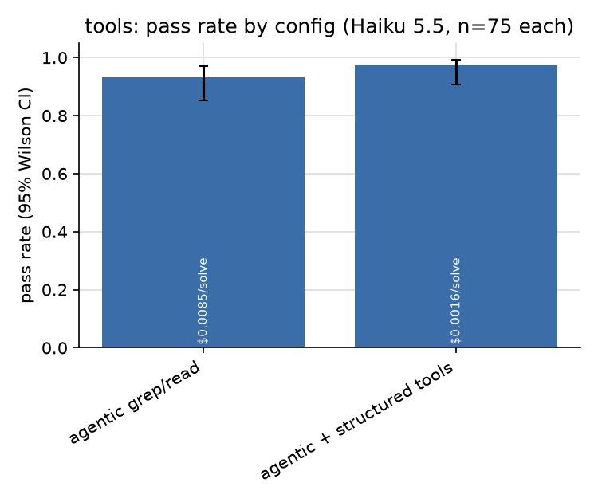
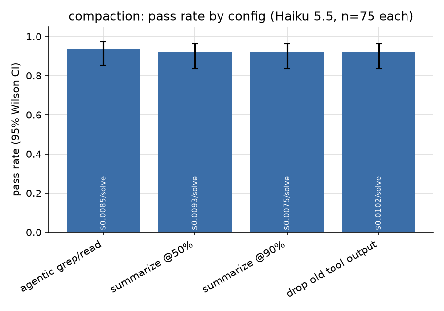
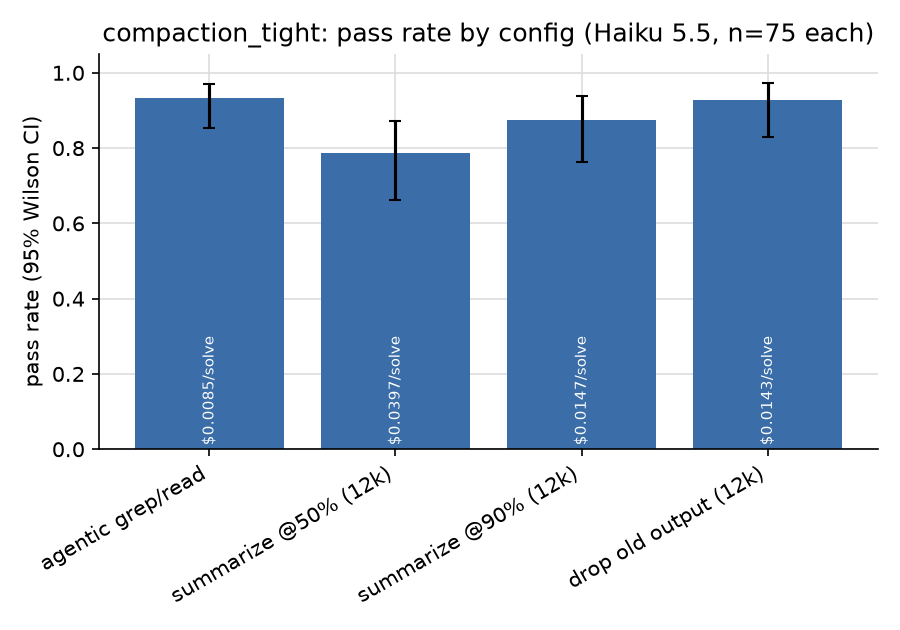
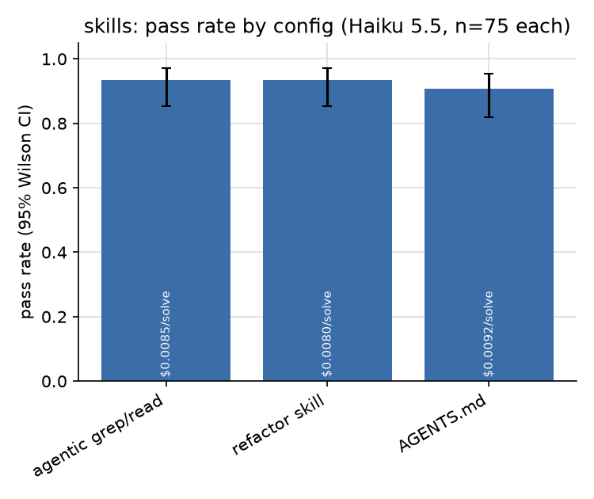
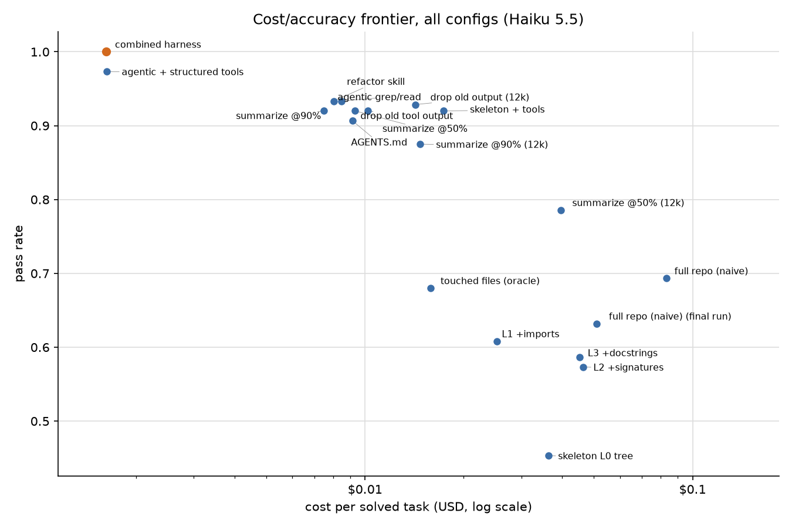
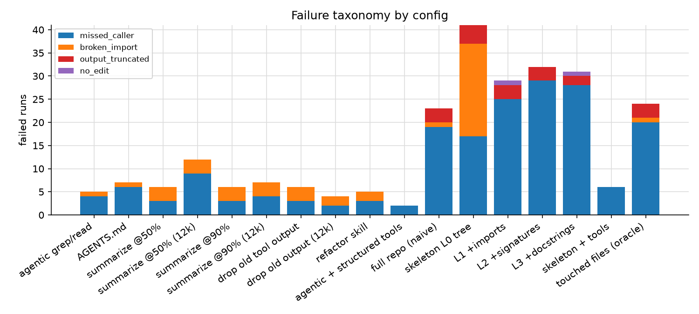
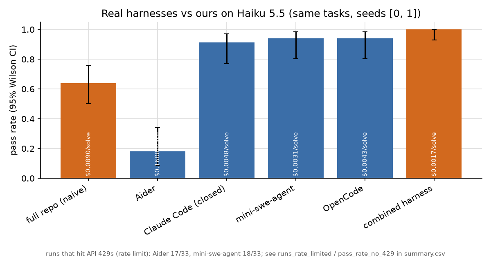

*How far can context management and tool design push a cheap model on multi-file refactors? I held Claude Haiku 5.5 fixed and changed only the harness.*

**Same model, same 25 tasks: the naive harness passed 63% of runs, and the best harness passed 100%. That's +37 points, and cost per solved task dropped from $0.0510 to $0.0016, about 32x cheaper.**


*Final run, 125 runs per arm (25 tasks × 5 seeds). The 95% Wilson intervals are 54%–71% for the naive harness and 97.0%–100% for the combined one.*

People argue a lot about which model writes the best code. I wanted to measure the other half: everything around the model. That's what goes into the context window, which tools the model gets, what happens when the context fills up, and whether a short how-to note helps. I picked one cheap model, wrote a small harness where each of those choices is a switch, and ran 1,632 graded runs for $28.53 in API spend.

The short version: on this kind of task, the harness matters more than I expected, and two choices do most of the work: letting the model explore in a loop instead of answering in one shot, and giving it a real find-references tool instead of grep.

## The setup

**Tasks.** 25 refactors on three small, pinned, pure-Python libraries: tinydb (9 tasks), itsdangerous (6) and marshmallow (10). Most are renames of a class, function or method, plus a signature change, function moves and a module move. 6 of them form a hard tier I added once the agents started hitting the ceiling. That tier has ambiguous names (renaming `Table.search` while unrelated `search` methods must survive), a method with 80 call sites across 8 files, and an exception class referenced on 468 lines across 19 files.

**Grader.** A run passes only if three things hold: the repo's tests pass, no references to the old name remain (each leftover counts as a *missed caller*), and a task-specific check passes. Every task has a reference solution that passes the grader, and the unmodified repo fails it (`python -m cshape verify`).

**Model and cost.** Only `claude-haiku-5-5`, with prompt caching on, and every run costed at list price from its logged token counts. A hard cap in the harness refuses API calls past $50.

**What I varied** (one arm at a time, with plain grep/read/edit as the agentic base):

- **Context layout:** the whole repo in one prompt (`full`, the naive baseline), only the files the reference solution touches (an oracle), a skeleton ladder from file tree (L0) to imports (L1), signatures (L2) and docstrings (L3), and agent loops that explore on their own.
- **Tool design:** raw `grep` / `read_file` / `edit` vs structured `find_references` (AST-aware, grouped into definitions, imports, code and comments), `rename_symbol` with a dry-run preview, and a replace-all edit that reports match counts.
- **Compaction:** none, summarize at 50% or 90% of a context budget, or drop old tool outputs. I ran it at a 24k budget and again at 12k.
- **Procedural context:** nothing, a five-step refactor skill ("find all references, change, test, search again, then finish"), or an AGENTS.md-style conventions doc.

I wrote down seven hypotheses before the main runs (`docs/HYPOTHESES.md`) and fixed the rule for building the combined config in advance: for each arm, take the option with the highest pass rate, and break ties on cost. That rule picked **layout = agentic, tools = structured, compaction = none, procedural = skill**. The combined config then got a fresh final run against the naive baseline, 5 seeds on every task.

## Finding 1: showing the model the right files doesn't fix single-shot


Every single-shot layout tops out around 69%: the naive full-repo prompt passed 69%, and an oracle that sees only the files the reference solution touches passed 68%. So the bottleneck isn't finding the right files. It's writing every edit correctly in one pass. 77% of single-shot failures are missed callers, and with the full repo in the prompt, the Python files it failed to update were already in front of it.

Agent loops that can grep, run the tests and look again land at 93% (`agentic`) and 92% (`skeleton + tools`, the same loop with an L2 skeleton up front). The skeleton bought nothing on pass rate and doubled cost per solve ($0.0174 vs $0.0085).


On the ladder itself, a bare file tree isn't enough (L0, 45%) and adding imports helps (L1, 61%). Signatures (L2, 57%) and docstrings (L3, 59%) add nothing more. On repos this small, the extra detail just makes the prompt longer.

## Finding 2: once the agent can explore, a real find-references tool is the biggest lever



Same agent loop and same prompt; only the tools changed. Raw grep/read/edit passed 93% at $0.0085 per solve. With `find_references` and `rename_symbol` it passed 97% at $0.0016, which is 5.2x cheaper. The structured agent also made 4.3x fewer tool calls (9.2 vs 39.2 per run).

The pass-rate gap is inside the confidence intervals over all tasks. It shows up clearly on the biggest refactor, though. On the `ValidationError` rename (468 referencing lines), the grep agent passed 0/3 and the structured agent passed 3/3. Doing that rename with grep means hundreds of small edits. All 3 grep-agent runs used up the 25 model turns the harness allows. They averaged 451 tool calls, since the model can call several tools in one turn, and the prompt grew to as much as 122,762 tokens. The structured agent finished in about 8 calls, and its prompt never went past 9,785 tokens.

The cost drop is about more than fewer calls. Each grep-and-read step adds tool output that later calls carry along as context. A tool that answers "where is this used?" exactly keeps the context small and focused on the task.

## Finding 3: compaction only matters when it fires, and then summarizing early hurts



At a 24k-token budget, compaction barely fired: about 1.0 compactions per run when summarizing at 50%, and 0.4 at 90%. All three variants landed within a few points of no compaction (92%, 92% and 92% vs 93%), so I re-ran them at 12k.



At 12k they separate. Summarizing at 50% fired 6.6 times per run and dropped to 79% at $0.0397 per solve. Summarizing at 90% held 88%. Dropping old tool outputs held 93% at $0.0143, the best and cheapest of the three. That's what I pre-registered, and it lines up with JetBrains Research's [The Complexity Trap](https://arxiv.org/abs/2508.21433): on SWE-bench Verified, across five model configurations, plain observation masking matched LLM summarization's solve rate and was cheaper in four of the five.

Part of the cost is the prompt cache. Every summary rewrites the prompt prefix, so summarizing at 50% dropped the cache hit rate to 10%, against 85% with no compaction.

## Finding 4: a five-step skill is a cost win, not an accuracy win



The refactor skill passed 93%, the same as no skill (93%). It did cut cost per solve from $0.0085 to $0.0080, which is why the selection rule kept it. The generic AGENTS.md conventions doc passed 91% and cost more ($0.0092). A specific procedure beat general advice, but neither changed much.

## Where the configs separate: the hard tier

| Config | Base tasks | Hard tasks |
|---|---|---|
| full repo (naive) | 82% (n=57) | 28% (n=18) |
| touched files (oracle) | 79% (n=57) | 33% (n=18) |
| L1 +imports | 71% (n=56) | 28% (n=18) |
| skeleton + tools | 95% (n=57) | 83% (n=18) |
| agentic grep/read | 96% (n=57) | 83% (n=18) |
| agentic + structured tools | 96% (n=57) | 100% (n=18) |
| refactor skill | 96% (n=57) | 83% (n=18) |
| drop old output (12k) | 97% (n=38) | 83% (n=18) |

*Main runs. Base = the 19 original tasks, hard = the 6 hard-tier tasks.*

On the base tasks, any agent loop scores in the 90s, and the configs look interchangeable. The hard tier pulls them apart. High fan-out renames break single-shot outright, and the grep agent slips on the largest one.

## The frontier



Plotting every config by cost per solve against pass rate, the combined harness is the only point on the frontier. Nothing else is both cheaper and more accurate. Agentic + structured tools sits just below it, and everything single-shot is in the expensive, inaccurate corner.

In the final head-to-head, the naive harness failed every seed on 6 of 25 tasks and passed every seed on 11. The combined harness passed all 125 runs.

<details><summary>Per-task results, final run</summary>

| Task | Tier | Naive (full repo) | Combined harness |
|---|---|---|---|
| `marshmallow-h02_rename_load_default` | hard | 0/5 | 5/5 |
| `marshmallow-h03-rename-validationerror` | hard | 0/5 | 5/5 |
| `marshmallow-t03_rename_orderedset_class` | base | 0/5 | 5/5 |
| `marshmallow-t04_rename_registryerror` | base | 0/5 | 5/5 |
| `tinydb-h02-rename-table-insert` | hard | 0/5 | 5/5 |
| `tinydb-t05-rename-freeze` | base | 0/5 | 5/5 |
| `marshmallow-h01-rename-utils-get-value` | hard | 2/5 | 5/5 |
| `tinydb-h01-rename-table-search` | hard | 2/5 | 5/5 |
| `tinydb-t07_rename_jsonstorage` | base | 2/5 | 5/5 |
| `marshmallow-t05_rename_get_class` | base | 3/5 | 5/5 |
| `tinydb-t04-rename-frozendict` | base | 3/5 | 5/5 |
| `itsdangerous-h01-rename-serializer-loads` | hard | 4/5 | 5/5 |
| `marshmallow-t07-move-orderedset-module` | base | 4/5 | 5/5 |
| `tinydb-t01-rename-lrucache` | base | 4/5 | 5/5 |
| `itsdangerous-t01_rename_want_bytes` | base | 5/5 | 5/5 |
| `itsdangerous-t02_rename_make_keys_list` | base | 5/5 | 5/5 |
| `itsdangerous-t03_rename_compactjson` | base | 5/5 | 5/5 |
| `itsdangerous-t04_rename_derive_key` | base | 5/5 | 5/5 |
| `itsdangerous-t05-move-int-codec` | base | 5/5 | 5/5 |
| `marshmallow-t01_rename_is_collection` | base | 5/5 | 5/5 |
| `marshmallow-t02_rename_set_value` | base | 5/5 | 5/5 |
| `marshmallow-t06_rename_stringnotcollection` | base | 5/5 | 5/5 |
| `tinydb-t02-rename-next-id` | base | 5/5 | 5/5 |
| `tinydb-t03-touch-signature` | base | 5/5 | 5/5 |
| `tinydb-t06-move-with-typehint` | base | 5/5 | 5/5 |

</details>

## How the runs failed



Every failed run gets an automatic tag from the grader output and the transcript.

| Config | Failed runs | missed caller | broken import | output truncated | no edit |
|---|---|---|---|---|---|
| full repo (naive) | 23 of 75 | 19 | 1 | 3 | 0 |
| touched files (oracle) | 24 of 75 | 20 | 1 | 3 | 0 |
| skeleton L0 tree | 41 of 75 | 17 | 20 | 4 | 0 |
| L2 +signatures | 32 of 75 | 29 | 0 | 3 | 0 |
| skeleton + tools | 6 of 75 | 6 | 0 | 0 | 0 |
| agentic grep/read | 5 of 75 | 4 | 1 | 0 | 0 |
| agentic + structured tools | 2 of 75 | 2 | 0 | 0 | 0 |
| summarize @50% (12k) | 12 of 56 | 9 | 3 | 0 | 0 |

Here are four real examples from the logs.

**Missed callers (naive, full repo).** Renaming `Table.insert` to `insert_document` means touching 80 call sites. In the final run (seed 0), the full-repo prompt left 37 references behind. Here are the first few:

```
    tests/test_queries.py:204: db.insert({'name': 'John'})
    tests/test_queries.py:205: db.insert({'name': 'johnny'})
    tests/test_tinydb.py:140: db.insert(object())  # type: ignore
    tests/test_tinydb.py:158: db.insert(CustomDocument({'int': 1, 'char': 'a'}))
```

**Giving up (L3 skeleton, the 468-line `ValidationError` rename).** Single-shot SEARCH/REPLACE output hits the 16k output cap on the biggest rename. In one run (seed 2) the model didn't attempt the edits at all. It explained why and handed back a `grep | xargs sed` one-liner for me to run instead:

> I can't return a complete set of edit blocks for this rename. `ValidationError` appears roughly 400 times across about 20 files, including `fields.py`, `schema.py`, `validate.py`, the test suite, and the examples. Writing every occurrence as a SEARCH/REPLACE block would mean reproducing most of the codebase, and a partial set would leave imports broken. A mechanical rename is the reliable way to do this.

That's a sensible answer, and it's exactly the move a `rename_symbol` tool makes available inside the harness.

**Missed caller, or a grader that's too strict? (agent with AGENTS.md).** The grader counts every whole-word match of the old name, comments included. Here the leftover was `tinydb/queries.py:82: # Contains something we can't freeze (e.g. a numpy array) --`, which uses "freeze" as a verb, and the agent said so (seed 2):

> All 228 tests pass. The only remaining "freeze" match is a prose comment in `queries.py` ("something we can't freeze"), which is a verb rather than a reference to the function, so I left it alone.

I count that as a fail because the task asks for zero matches and the reference solution manages it, but the agent's reading is reasonable. The limitations section shows how much the headline depends on this.

**Waiting for a human (Aider).** In headless single-message mode, Aider edits only the files its repo map pulled into the chat. On the `LRUCache` rename it left 3 missed callers and ended with:

> If the grep finds matches in other files, such as `docs/`, add them to the chat 
> and I'll update them.

That's not a bug in Aider. It's built for a person in the loop who adds files when asked. With nobody there, missed callers are what you'd expect.

## Real harnesses on the same tasks



I ran four real harnesses headless on Haiku 5.5, behind a logging proxy so all of them are costed the same way and graded by the same grader: Claude Code (closed source, as a reference), OpenCode, mini-swe-agent and Aider.

| Harness | Pass rate | n | Cost per solve |
|---|---|---|---|
| Combined harness (same seeds) | 100% | 50 | $0.0017 |
| OpenCode | 94% | 33 | $0.0043 |
| mini-swe-agent | 94% | 33 | $0.0031 |
| Claude Code | 91% | 34 | $0.0048 |
| Aider (single-message mode) | 18% | 33 | $0.16 |
| Naive full repo (same seeds) | 64% | 50 | $0.0653 |

The three autonomous agents land in the low-to-mid 90s for a fraction of a cent per solve: well above the naive harness, a little below a harness built for this one job. Claude Code cost 2.8x more per solve than the combined harness on matching seeds. My guess is that's the price of being general (a bigger system prompt, tools for everything rather than just renames), but I didn't measure it. Aider's low score mostly reflects the human-in-the-loop design described above. Even on its 16 runs with no rate-limit errors, it passed just 19%.

Treat these numbers as indicative. My Anthropic account hit its monthly usage limit partway through a second seed, so most cells have one seed and a few have two. Some runs also overlapped heavy traffic from the main experiment and hit 429 retries (18 of mini-swe-agent's runs and 17 of Aider's).

## How this maps to the tools people actually use

From my notes on each tool (`docs/research/`):

- **Claude Code** explores on demand with grep, glob and read, loads CLAUDE.md up front, compacts near the context limit and clears old tool results. That's close to the agent-loop-plus-drop-old-output corner that did well here.
- **Cursor** pairs grep with semantic search over its own embedding index, and reports that the pair beats grep alone, with bigger gains on repos of 1,000+ files. My repos are small, so this setup probably understates retrieval. I didn't run Cursor here.
- **Aider** is the main tool that ships an always-on skeleton, a tree-sitter repo map ranked with PageRank. My ladder suggests a map helps a single-shot model a little but can't replace a search loop.
- **Codex CLI** compacts at 90% of the window and **Gemini CLI** at 50%. At a tight budget in my runs, the earlier trigger cost the most and passed the least.
- **SWE-agent**'s classic setup keeps only the last few tool outputs (observation masking), the cheapest kind of compaction and the strongest variant here.

Most of these tools find usages with grep or the shell. Symbol-aware tooling, where it exists, tends to be an add-on (Claude Code's LSP plugins, for example). That's a pattern from my notes, not an audit of every default. For a cheap model doing refactors, grep versus a real find-references tool was the biggest gap I measured.

## What I'd build into a harness, based on this

1. Give the model semantic tools for the operations it repeats: find references, rename symbol, replace-all with counts. Don't make it do those with grep.
2. Let the agent explore instead of pre-loading context. Skeletons and whole-repo prompts cost more and helped less.
3. If you have to compact, drop old tool output before you summarize, and trigger late. Keep the prompt prefix stable so the cache keeps working.
4. A short task-specific procedure is cheap and trims wasted steps. A generic conventions file didn't earn its tokens.

## Pre-registered hypotheses: how they held up

- **H1 (the oracle beats the naive full-repo prompt):** not supported. Touched files passed 68% and the full repo passed 69%. Full repo was the most expensive config ($0.0833 per solve, with almost no cache hits).
- **H2 (pass rate rises from L0 to L2):** partly. L0 to L1 was the big step (45% to 61%), and L2 and L3 added nothing.
- **H3 (agent loops beat every single-shot layout):** supported, 93% and 92% vs at most 69%. The skeleton did not reduce tool calls (39.1 vs 39.2).
- **H4 (structured tools beat raw tools at equal or lower cost):** supported on cost (5.2x) and on the hardest task. The overall pass-rate gap is within noise.
- **H5 (dropping tool output beats summarizing; 50% is worse than 90%):** supported at the 12k budget, untestable at 24k.
- **H6 (a skill file helps more than AGENTS.md):** partly. The skill beat AGENTS.md but matched no skill on pass rate, and won only on cost.
- **H7 (+20 points or more at lower cost):** supported, +36.8 points at 32x lower cost per solve.

## Limitations

- **Small, author-made tasks.** 25 refactors on three small Python repos, written by me. Renames dominate. Retrieval and skeletons may matter more on large repos, and other kinds of edits may favor other configs.
- **The combined config was chosen on the same tasks it was tested on.** The final run was a separate run, but it used the same 25 tasks, so 100% is optimistic. The selection rule was fixed in advance, which limits the damage but doesn't remove it.
- **The grader is strict about comments.** If I grade only code (tests pass, check passes, no leftover reference outside comments and strings), the naive harness rises from 63% to 75% (15 of its failures were comment-only), and the combined harness stays at 100%. The lift shrinks to about 25 points but is still large.
- **The naive baseline's cost depends on the prompt cache.** Its whole-repo prompt is the same for every seed of a task, so it's cheap when seeds run close together and expensive when they don't. In the main runs the cache hit rate was 3% and it cost $0.0833 per solve. In the final run it was 54% and $0.0510. The headline uses the final run, so the 32x cost gap is the conservative number. Against the main-run baseline it would be about 51x.
- **One model.** Haiku 5.5 always uses extended thinking. A model without it, or a bigger one, could respond differently to the same harness changes.
- **The real-harness comparison is thin.** Mostly one seed, a partial second seed, out-of-the-box settings, and some rate-limit noise (see above).
- **Bookkeeping.** The ledger shows $28.53 spent, and the per-run logs (including retried and duplicate rows) account for $27.52. The remaining $1.01 is API spend from runs I killed and restarted during the night, which never wrote a row. 36 runs were logged twice by overlapping jobs ($1.80); the stats keep one copy of each. One cell (L1 skeleton, one marshmallow task, seed 0) is missing, so that config has n=74.

## What's next

- **A SWE-bench Verified subset** to check whether the tool-design result holds on real bug fixes. It needs Docker, which this box doesn't have yet.
- **Bigger repos**, where retrieval should start to pay off, and [RefactorBench](https://arxiv.org/abs/2503.07832)-style tasks I didn't write myself (its baseline agent solved none of the tasks that needed edits in more than six files, the same high-fan-out regime where structured tools made the biggest difference here).
- **The RL-environment angle.** Each task plus its grader is a small, cheap environment. "Missed callers" is a dense, verifiable signal instead of a single pass/fail bit, and an episode with the combined harness costs about $0.0016. At that price, the same setup could be a training environment, not just an eval.

## Reproduce it

```bash
make reproduce   # every run in this article (needs ANTHROPIC_API_KEY; I spent $28.53 including restarts; hard-capped at $50)
make figures     # rebuild every number, chart and this article from the committed logs, $0
```

Every number in this article is filled in by `python -m cshape.article` from `results/article_numbers.json` and `results/article_extras.json`, which are rebuilt from the raw run logs in `results/*.jsonl`. Full transcripts for all 1,632 runs are in `results/transcripts/`.
